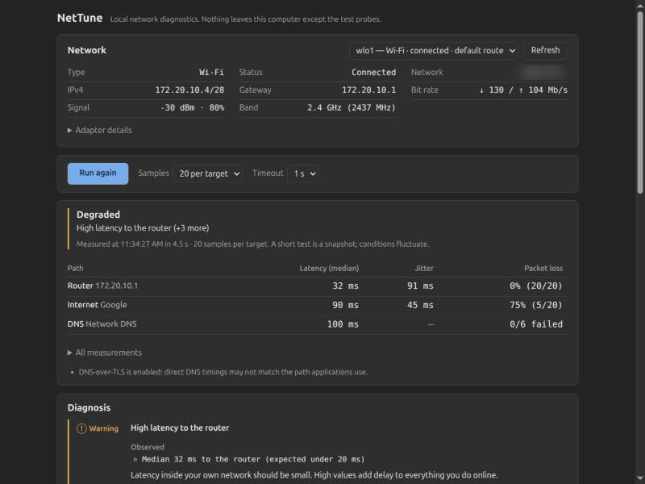
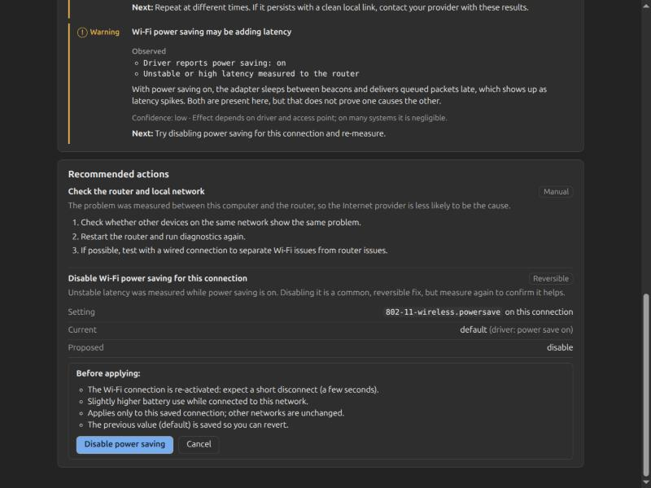

# NetTune — Linux network diagnostics & Wi-Fi lag troubleshooter

[](LICENSE)


**NetTune** is a free, open-source, local-first **network diagnostic tool for Linux desktops**
(Ubuntu + NetworkManager). It measures **ping latency, jitter, packet loss and DNS lookup time**,
tells you *where* the problem is (Wi-Fi link, router, ISP or DNS), and recommends evidence-based
fixes — including a safe, reversible **Wi-Fi power-saving** toggle with before/after comparison.

*Why is my internet slow? Why does my connection lag in games or video calls?* NetTune answers
with real measurements instead of guesses.



## Download

Grab the `.deb` from the [latest release](https://github.com/ttat288/nettune/releases/latest) and install it:

```bash
sudo apt install ./NetTune_0.1.0_amd64.deb
```

Then launch **NetTune** from your application menu. Or build it from source (see below).

## Features

- Detects network interfaces: Wi-Fi signal (dBm), band, bit rate, Ethernet link speed and duplex, driver, IP, gateway and DNS.
- Measures latency, jitter and packet loss to your router and to public servers using multiple samples.
- Benchmarks DNS: your network resolver vs. Cloudflare, Google and Quad9.
- Separates local (Wi-Fi/router) problems from ISP/upstream problems.
- Explains every finding with evidence, confidence and limitations; never claims a guaranteed fix.
- Offers one safe, reversible optimization (Wi-Fi power saving via NetworkManager) with backup, verification and one-click revert.
- Before/after comparison that ignores normal noise.
- No cloud, no account, no telemetry. Runs unprivileged; asks for authorization only for the one change.



## How it works

**Workflow:** Detect → Diagnose → Recommend → Apply safely → Verify (before/after).

- No cloud, accounts, telemetry or AI services. Results stay in memory; nothing is uploaded.
- The only network traffic is the probes themselves: ping to your router and to Cloudflare
  (1.1.1.1), Google (8.8.8.8) and Quad9 (9.9.9.9), small DNS queries, and TCP handshakes
  to port 443 only when ping is blocked.
- No download/upload speed test. NetTune never invents numbers; unavailable values show `—`.

## What it measures

| Area | Source | Privileges |
|---|---|---|
| Interfaces, addresses, MTU, MAC | `ip -j addr`, `/sys/class/net` | none |
| Default route / gateway | `ip -j route` | none |
| Connection state, profile, DNS servers | `nmcli` (optional) | none |
| Wi-Fi signal, frequency, bit rate, power save | `iw dev <if> link`, `iw dev <if> get power_save`, `nmcli dev wifi` | none |
| Ethernet speed / duplex / autoneg | `ethtool <if>`, `/sys/class/net/<if>/speed` | none |
| Latency, jitter, packet loss | `ping -n -c N -i 0.2 -W T` (iputils) | none (unprivileged ICMP) |
| TCP fallback when ICMP is filtered | TCP connect timing to port 443 | none |
| DNS lookup time | hand-built UDP queries sent directly to each resolver | none |
| Gateway neighbor state (when ping gets no reply) | `ip -j neigh` | none |

Jitter is the mean absolute difference between consecutive round-trip times. Each run uses 10, 20
or 50 samples per target. The per-reply timeout is 1–3 s. Every probe has a hard time limit, so a
run always finishes. A run typically takes 5–20 s; the worst case is about 35 s, with 3 s timeouts
and the TCP fallback.

## Diagnosis rules

`src-tauri/src/rules.rs` is deterministic and pure. It is unit-tested with fixtures. Every finding
lists the observed evidence, an explanation, a confidence level with its limitations, and a next
step. Examples:

- Router unreachable vs. router ignoring ping while the Internet works.
- Packet loss on the local link vs. loss only beyond the router (ISP/upstream).
- High or unstable latency (jitter, spikes) to the router or the Internet.
- Ping blocked upstream while TCP works.
- Slow, failing or intermittent DNS. A public resolver noticeably faster than the configured one.
- Weak Wi-Fi signal. Wi-Fi power saving combined with latency spikes (flagged as correlation only).
- Ethernet negotiated below 1 Gb/s, half duplex, auto-negotiation off.

## The one automatic change: Wi-Fi power saving

When **all** of the following hold, NetTune offers to set `802-11-wireless.powersave = disable` on
the *active connection profile only*:

- The interface is Wi-Fi, managed by NetworkManager, and has an active profile.
- The driver reports its power-save state through `iw`, so the result can be verified.
- polkit allows modifying the profile.

How it works:

1. It shows the setting, its current and proposed value, and the side effects (short reconnect,
   slightly higher battery use). An inline confirmation is required.
2. It writes the previous value to `~/.local/state/nettune/wifi-powersave-backup.json`
   (mode 0600) **before** anything changes. That file holds only the interface name, the
   connection UUID and the values.
3. It runs `nmcli connection modify <uuid> 802-11-wireless.powersave disable`. NetworkManager and
   polkit authorize exactly this action. NetTune never runs as root and never uses a shell.
4. It runs `nmcli --wait 30 connection up <uuid>`. A reconnect is required because NetworkManager
   cannot reapply this setting live. If activation fails, the previous value is restored
   immediately.
5. It verifies by reading the profile back and checking that `iw` reports power save off. If the
   driver ignores the setting, NetTune says so and does not report success.
6. Run diagnostics again to compare before and after. Then choose **Keep change** or **Revert…**.
   Revert restores the saved value and re-activates the connection. The backup survives restarts,
   so Revert stays available.

The comparison only calls a metric better or worse beyond a noise margin. For latency that margin
is 2 ms or 15%, whichever is larger. Everything else is "No clear change".

NetTune does **not** change DNS, IPv6, offloads, firewalls, sysctls or driver parameters. Those
appear only as manual recommendations with copyable `nmcli`/`ethtool` commands and undo steps.

## Requirements

Runtime: Ubuntu 22.04+ (developed on 26.04), WebKitGTK 4.1, `iproute2`, `iputils-ping`. Optional:
`network-manager` (nmcli), `iw`, `ethtool`. When a tool is missing, NetTune reports it and hides
the features that depend on it.

Build:

```bash
sudo apt install libwebkit2gtk-4.1-dev libssl-dev libxdo-dev libayatana-appindicator3-dev librsvg2-dev file rustc cargo rustfmt rust-clippy nodejs npm
```

Rust ≥ 1.77 and Node ≥ 20.19 are required. Ubuntu 26.04 ships Rust 1.93 and Node 22.

## Development

```bash
npm install
npm run tauri dev
```

Checks: TypeScript typecheck, `cargo fmt --check`, `clippy -D warnings`, and the Rust unit tests.

```bash
npm run check
```

Read-only command-line run of one diagnostic pass, printed as JSON:

```bash
cargo run --manifest-path src-tauri/Cargo.toml --example diagnose -- wlo1 20 1000
```

## Build and install

```bash
npm run tauri build
```

```bash
sudo apt install ./src-tauri/target/release/bundle/deb/NetTune_0.1.0_amd64.deb
```

The unbundled binary is at `src-tauri/target/release/nettune`.

## Usage

1. Pick the interface. The default-route interface is preselected. **Adapter details** shows the
   rest.
2. Choose the number of samples and the timeout, then press **Run diagnostics**.
3. Read the summary table (router / Internet / DNS), then **Diagnosis** and
   **Recommended actions**. **All measurements** shows per-target and per-resolver data.
4. If offered, review and apply the Wi-Fi power-saving change. Run again, compare, then keep or
   revert it.

Short tests are snapshots. Wi-Fi and Internet conditions fluctuate, so repeat runs before drawing
conclusions.

## Project layout

```
src-tauri/src/
  cmd.rs        safe process runner (argv only, timeout, kill), nmcli escaping
  detect.rs     interface detection + parsers
  probe.rs      ping / TCP / DNS probes + statistics
  diagnose.rs   one bounded, concurrent diagnostic pass
  rules.rs      diagnosis + recommendations (pure)
  compare.rs    before/after comparison (pure)
  powersave.rs  the reversible Wi-Fi power-save change
  lib.rs        Tauri commands; a single busy guard prevents overlapping runs/changes
src/            React + TypeScript UI (no UI framework)
.claude/skills/ project design system (nettune-design), frontend-ui-ux (MIT), caveman (Apache-2.0)
```

## Known limitations

- Linux and NetworkManager only. Systems that use systemd-networkd or ifupdown get diagnostics but
  no automatic change.
- DNS timings use direct UDP queries to each resolver. With DNS-over-TLS or a local cache
  (systemd-resolved), applications may take a different path. NetTune points this out when it
  detects it.
- Internet tests follow the system's default route, even when another interface is selected.
- Link-local IPv6 DNS servers and gateways are not probed.
- Ethernet checks depend on what the driver exposes without root.

## License

MIT. Vendored skills keep their own licenses (see `.claude/skills/*/LICENSE`).
